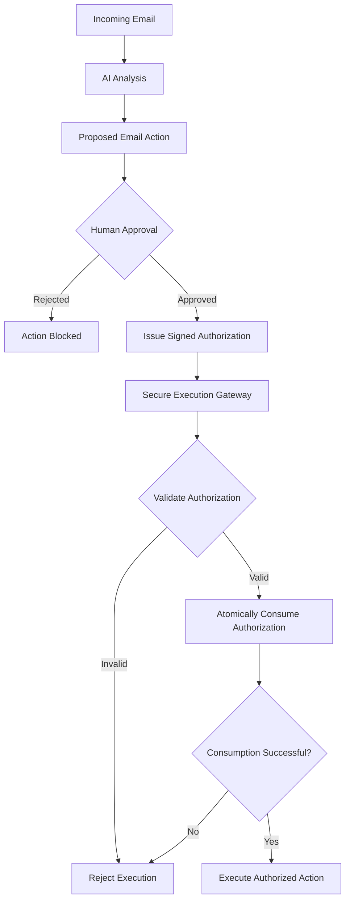

# SafeMail AI Email Agent

**A security-first AI email agent designed to prevent unauthorized and irreversible autonomous actions.**

SafeMail combines Google Gemini, LangGraph, human-in-the-loop approval, cryptographically signed authorization, and a secure execution gateway to protect email operations.

**AI can analyze and draft emails, but it cannot authorize its own actions.**

## AI Safety Challenge

**Challenge:** Prevent Irreversible Autonomous Actions

**Project repository:** https://github.com/himnad/safemail-ai-email-agent

### The Problem

AI agents can perform useful tasks such as reading emails, generating replies, and interacting with external services. However, allowing an AI agent to execute sensitive actions without proper authorization introduces serious security risks.

Examples include:

- Sending an email without human approval.
- Modifying the recipient after approval.
- Changing the email subject or body.
- Reusing an authorization token.
- Forging authorization to bypass human review.

SafeMail addresses these risks by separating AI-generated decisions from the authority to execute them.

## Key Features

### 1. AI-Powered Email Processing

- Uses Google Gemini for email analysis and reply generation.
- Uses LangGraph to organize the email-processing workflow.
- Supports Gmail integration through the Gmail API and OAuth.
- Keeps AI-generated output separate from execution authorization.

### 2. Human-in-the-Loop Approval

Sensitive email actions require explicit human authorization.

- AI prepares the proposed action.
- A human reviews the request.
- Approved requests can receive signed authorization.
- Rejected or unauthorized requests cannot obtain valid execution authorization.

### 3. Cryptographically Signed Authorization

SafeMail uses HMAC-based authorization tokens to protect approved actions.

The gateway validates:

- Authorization signature
- Trusted issuer
- Intended audience
- Issue time and expiration
- Exact recipient
- Exact email subject
- Exact email body

Changing the approved email content invalidates authorization.

### 4. Replay Protection

Authorization is designed for one-time use.

The gateway atomically consumes the stored authorization record to prevent the same authorization from being reused.

### 5. Secure Execution Gateway

Sensitive email execution is controlled through a dedicated gateway.

The gateway verifies authorization before permitting the approved action.

Invalid, expired, tampered, forged, or previously consumed authorization is rejected.

### 6. Interactive Demonstration Dashboard

The project includes a FastAPI-based demonstration dashboard with:

- Sample emails
- AI-powered analysis
- Simulated approval and rejection
- Dynamic card updates using JavaScript
- A demonstration workflow separate from real Gmail sending

The demonstration interface is not evidence that a real Gmail message was sent.

## Security Architecture



**Core safety principle:** AI proposes. Humans authorize. The gateway enforces.

## Security Testing

The project includes automated unit, adversarial, and integration tests.

### Verified local results

**General test suite:**

```text
51 passed, 5 subtests passed
```

**Signed-gateway integration tests:**

```text
7 passed
```

These results were obtained during local development.

### Tested Security Scenarios

| Security scenario | Expected behavior |
|---|---|
| Valid signed authorization | Authorized mock send succeeds once |
| Modified recipient | Execution rejected |
| Modified subject | Execution rejected |
| Modified email body | Execution rejected |
| Modified authorization key | Execution rejected |
| Forged authorization token | Execution rejected |
| Unapproved request | Cannot issue valid authorization |
| Reused authorization | Prevented by one-time consumption |

## Technology Stack

| Component | Technology |
|---|---|
| Programming language | Python |
| AI model | Google Gemini |
| Agent orchestration | LangGraph |
| API framework | FastAPI |
| Dashboard |