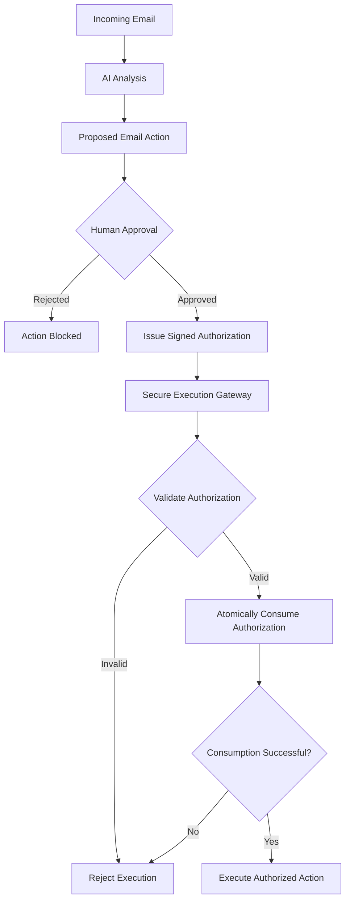

# 🛡️ SafeMail AI Email Agent

**A security-first AI email agent designed to prevent unauthorized and irreversible autonomous actions.**

SafeMail combines **Google Gemini, LangGraph, human-in-the-loop approval, cryptographically signed authorization, and a secure execution gateway** to protect AI-driven email operations.

**Core principle: AI proposes. Humans authorize. The gateway enforces.**

---

## 🏆 AI Safety Challenge

**Challenge:** Prevent Irreversible Autonomous Actions

**Project Repository:** https://github.com/himnad/safemail-ai-email-agent

SafeMail demonstrates how AI agents can perform useful tasks while separating AI-generated decisions from the authority to execute sensitive actions.

The project focuses on preventing unauthorized email sending, approval tampering, forged authorization, and replay attacks.

---

## 1. The Problem

AI agents can automate tasks such as reading emails, classifying messages, generating replies, and interacting with external services.

However, allowing an AI agent to execute sensitive actions without proper authorization introduces serious security risks.

Examples include:

- Sending an email without human approval.
- Changing the recipient after approval.
- Modifying the subject or email body.
- Reusing an authorization token to execute an action multiple times.
- Forging authorization to bypass human review.
- Executing an AI-generated action that differs from what the user approved.

These problems become especially important when AI agents interact with external systems and perform actions that cannot easily be reversed.

### Our Solution

SafeMail separates the system into three responsibilities:

1. **AI Agent:** Analyzes emails and proposes actions.
2. **Human Reviewer:** Reviews and authorizes proposed actions.
3. **Secure Execution Gateway:** Validates authorization before allowing execution.

The AI agent cannot independently grant itself permission to perform protected actions.

---

## 2. Key Features

### 2.1 AI-Powered Email Processing

SafeMail uses Google Gemini and LangGraph for intelligent email processing.

Capabilities include:

- Email classification and analysis.
- AI-generated reply drafting.
- Workflow orchestration using LangGraph.
- Gmail API and OAuth integration.
- Separation of AI-generated content from execution authorization.

### 2.2 Human-in-the-Loop Approval

Sensitive email actions require explicit human authorization.

The workflow follows these steps:

1. The AI generates a proposed email action.
2. The human reviews the recipient, subject, and body.
3. The human approves or rejects the proposed action.
4. Approved requests can receive signed authorization.
5. Rejected or unauthorized requests cannot obtain valid execution authorization.

This prevents the AI agent from independently authorizing protected email operations.

### 2.3 Cryptographically Signed Authorization

SafeMail uses **HMAC-based signed authorization tokens** to protect approved actions.

The gateway validates:

- Cryptographic signature.
- Trusted token issuer.
- Intended token audience.
- Token issue time.
- Token expiration.
- Approved recipient.
- Approved subject.
- Approved email body.

Authorization is bound to the approved action.

If the recipient, subject, body, or other protected authorization data changes, validation rejects the modified request.

### 2.4 Email Tampering Protection

SafeMail protects the integrity of human-approved email actions.

**Example:**

A user approves the following email:

- Recipient: `manager@example.com`
- Subject: `Project Update`
- Body: `The project report is ready.`

An attacker attempts to change the recipient to `attacker@example.com` after approval.

Because the modified action no longer matches the signed authorization, the security gateway rejects execution.

The same principle applies to unauthorized changes to the subject or body.

### 2.5 Replay Attack Prevention

SafeMail implements one-time authorization consumption.

Once an authorization has been successfully consumed, it cannot be reused to authorize another execution.

The gateway uses atomic consumption of the stored authorization record to prevent multiple requests from successfully consuming the same authorization.

This is designed to protect against replay attacks, including concurrent attempts to reuse an authorization.

### 2.6 Secure Execution Gateway

Sensitive execution is controlled through a dedicated security gateway.

Before permitting a protected action, the gateway checks:

1. Whether authorization exists.
2. Whether the signature is valid.
3. Whether the authorization has expired.
4. Whether the proposed action matches the approved content.
5. Whether the authorization has already been consumed.

Invalid, expired, forged, tampered, or previously consumed authorization is rejected.

### 2.7 Interactive Demonstration Dashboard

SafeMail includes a FastAPI-based demonstration dashboard.

The dashboard provides:

- Synthetic sample emails.
- AI-powered analysis.
- Simulated approval and rejection.
- Dynamic interface updates using JavaScript.
- A demonstration workflow separated from real Gmail sending.

The demonstration interface does not establish that a real Gmail message was delivered.

---

## 3. Security Architecture



**Core safety principle: AI proposes. Humans authorize. The gateway enforces.**

### Security Design

SafeMail uses separation of responsibilities to reduce the risk of unauthorized autonomous execution.

The AI model generates content and recommendations but does not control the cryptographic authorization mechanism.

Human approval establishes permission for a specific proposed action.

The secure execution gateway independently validates the authorization before allowing the action.

This design avoids relying exclusively on LLM instructions or prompts to enforce sensitive execution permissions.

---

## 4. Security Testing and Evidence

SafeMail includes automated unit, adversarial, and integration tests.

### Previously Verified Local Test Results

**General test suite:**

```text
51 passed, 1 warning, 5 subtests passed
```

**Signed-gateway integration tests:**

```text
7 passed
```

These results were obtained during local development and should be reproduced against the current repository version.

The seven signed-gateway integration tests are included in the complete test suite.

### Tested Security Scenarios

| Security Scenario | Expected Behavior |
|---|---|
| Valid signed authorization | Authorized mock send succeeds once |
| Modified recipient | Execution rejected |
| Modified subject | Execution rejected |
| Modified email body | Execution rejected |
| Modified authorization key | Execution rejected |
| Forged authorization token | Execution rejected |
| Unapproved request | Cannot issue valid authorization |
| Reused authorization | Prevented by one-time consumption |

### Why These Tests Matter

These tests demonstrate that the authorization mechanism is intended to protect the exact action approved by a human.

They also help verify that a malicious or modified request cannot bypass authorization simply by changing the email content after approval.

The tests use mocked external operations and should not be interpreted as proof of live Gmail delivery or a complete security audit.

---

## 5. Demonstration and Supporting Evidence

### Public AI Email Workflow Demo

**Try the existing Streamlit demonstration:**

https://email-ai-agent-eqmi8z5twq97kwglgfdi2g.streamlit.app/

This public demo showcases the original AI-powered email workflow.

It demonstrates the general concept of:

- Synthetic email processing.
- AI-assisted email analysis and drafting.
- Human review and approval.
- Simulated email sending.

**Important distinction:**

The Streamlit website is an AI email workflow demonstration. It is not currently presented as proof that SafeMail's signed authorization, tampering protection, or replay prevention mechanisms are integrated into that deployed interface.

All public demo emails are synthetic. Approval simulates sending; it does not send real Gmail messages.

### SafeMail Security Evidence

The SafeMail repository provides security implementation code and automated tests covering signed authorization, tampering detection, and authorization misuse.

Reviewers can inspect and run the tests to evaluate the gateway behavior independently.

### Local FastAPI Demonstration

The repository also contains a FastAPI-based demonstration dashboard.

Example startup command:

```cmd
python -m uvicorn approval_service.app:app --host 127.0.0.1 --port 8000
```

Example local address:

```text
http://127.0.0.1:8000/demo/login
```

These startup instructions have not yet been independently verified in a clean environment. Additional configuration may be necessary.

The local demonstration uses sample emails and simulated actions rather than proving live Gmail delivery.

---

## 6. Technology Stack

| Component | Technology |
|---|---|
| Programming Language | Python |
| AI Model | Google Gemini |
| Agent Orchestration | LangGraph |
| API Framework | FastAPI |
| Demonstration Dashboard | HTML, CSS, JavaScript |
| Existing Public Workflow Demo | Streamlit |
| Email Integration | Gmail API, Google OAuth |
| Authorization | HMAC-signed tokens |
| Testing | pytest |
| Configuration | Environment variables |

---

## 7. Repository Structure

```text
safemail-ai-email-agent/
│
├── agent/
│   └── AI processing and reply generation
│
├── approval_service/
│   └── Human approval and signed authorization
│
├── gmail/
│   └── Gmail integration
│
├── graph/
│   └── LangGraph workflow orchestration
│
├── safemail/
│   └── Secure gateway and policy enforcement
│
├── tests/
│   └── Automated security tests
│
├── demo/
│   └── Demonstration components
│
├── tools/
│   └── Email-related tools
│
├── ui/
│   └── Application interface
│
├── web_app/
│   └── Web application components
│
├── main.py
├── requirements.txt
├── README.md
└── LICENSE
```

---

## 8. Installation

### Step 1: Clone the Repository

```cmd
git clone https://github.com/himnad/safemail-ai-email-agent.git
cd safemail-ai-email-agent
```

### Step 2: Create a Virtual Environment

For Windows CMD:

```cmd
py -m venv venv
venv\Scripts\activate
```

### Step 3: Install Dependencies

```cmd
python -m pip install -r requirements.txt
```

### Step 4: Configure Environment

The project uses environment variables for configuration.

Real Gemini API requests require valid API credentials.

Gmail-integrated execution additionally requires appropriate Google OAuth credentials and configuration.

Do not commit API keys, OAuth tokens, signing secrets, or private email data to the repository.

---

## 9. Running Automated Tests

### Run the Complete Test Suite

For mocked tests, configure a placeholder Gemini API key:

```cmd
set GOOGLE_API_KEY=test-key-for-mocked-tests
python -m pytest -q --tb=short
```

Previously verified local result:

```text
51 passed, 1 warning, 5 subtests passed
```

### Run Signed-Gateway Integration Tests

```cmd
python -m pytest tests\test_signed_gateway_integration.py -v
```

Previously verified local result:

```text
7 passed
```

The placeholder Gemini key is intended only for mocked tests. Real API requests require valid credentials.

### Security Verification

The signed-gateway integration tests cover authorized execution and attempts to bypass authorization through content modification, invalid signatures, or missing approval.

These tests provide reproducible evidence of the implemented security controls within the tested environment.

---

## 10. Security Limitations and Future Improvements

SafeMail is a research prototype demonstrating secure authorization for AI-driven email actions.

Although the project implements multiple security controls, several limitations remain.

### Known Limitations

**1. Signing-Key Security**

HMAC-based authorization depends on protecting the signing secret.

If the secret is compromised, an attacker may be able to forge authorization tokens.

**2. Production Readiness**

Additional authentication hardening, secure secret management, monitoring, and deployment testing are required before production use.

**3. AI-Generated Content**

Google Gemini may generate inaccurate or inappropriate responses.

Human review remains necessary before executing sensitive email actions.

**4. Security Testing Coverage**

Automated tests cover important authorization, tampering, and replay scenarios.

However, these tests do not constitute an independent penetration test or comprehensive security audit.

**5. Demonstration Scope**

The demonstration dashboard uses sample emails and simulated actions.

The existing public Streamlit demo does not demonstrate the full SafeMail security gateway.

**6. External Dependencies**

Real Gmail integration depends on external API availability, OAuth configuration, credential security, and service permissions.

### Future Improvements

- Expand adversarial testing to cover additional attack scenarios.
- Introduce production-grade secret management and monitoring.
- Improve authentication and deployment security.
- Add security-focused demonstration videos and screenshots.
- Explore Chrome extension integration for convenient human review and approval.
- Evaluate additional authorization policies for other irreversible AI actions.

SafeMail demonstrates a security-first architecture and does not claim to be a fully audited production security platform.

---

## 11. Why SafeMail Matters

AI agents are increasingly capable of performing actions on behalf of users.

However, generating a useful response and having permission to execute an irreversible action are fundamentally different responsibilities.

SafeMail demonstrates an architecture in which:

- AI can analyze information and propose actions.
- Humans retain control over authorization.
- Cryptographic verification protects approved action details.
- The execution gateway enforces authorization independently of the AI model.
- Replay protection restricts repeated use of authorization.

The underlying approach can potentially be extended beyond email to other sensitive agent operations, such as financial workflows, administrative changes, and external API actions.

**AI proposes. Humans authorize. The gateway enforces.**

---

## 12. License

Licensed under the [MIT License](LICENSE).

---

**SafeMail AI Email Agent — Building safer AI automation through human authorization, cryptographic verification, and controlled execution.**